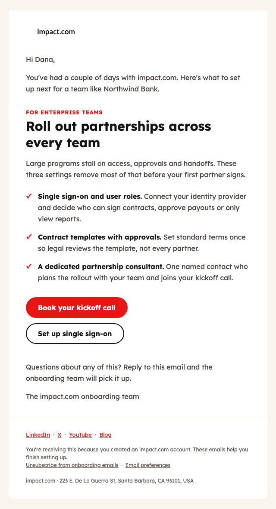

# SendGrid onboarding email series

Three onboarding emails for impact.com's platform, sent through SendGrid when a user signs up. The second email changes by `account_type` and the third by `industry`. Built for the Growth Enablement Developer take-home.

**Live preview:** [sendgrid-onboarding-system.vercel.app](https://sendgrid-onboarding-system.vercel.app) (change the signup and watch the real templates re-render)



## Start here if you don't work in code

You don't need a GitHub account or any setup. This takes about 5 minutes:

1. **See the emails.** Open the [live preview](https://sendgrid-onboarding-system.vercel.app), pick an email, then change the account type or industry and watch it update.
2. **See what testing found.** Read [What testing has caught so far](docs/QA_CHECKLIST.md#what-testing-has-caught-so-far).
3. **See the plan for the team.** Read [What I'd do in week 1](#what-id-do-in-week-1).

| Question | Answer |
|---|---|
| What happens when someone signs up? | They get three emails: a welcome straight away, one on day 2 matched to their account type, and one on day 5 matched to their industry. |
| What if the signup data is wrong or blank? | They still get a sensible email. A missing first name becomes "Hi there", and an account type or industry we haven't planned for gets a general version. |
| What can we report on? | Once the reporting feed is built: deliveries, opens, clicks and bounces for each email, split by account type and industry. Clicks are the main measure, because Apple Mail makes open counts look higher than they are. |
| Can it go live today? | Not yet. The templates are built and tested, but the steps below need to happen first. |

| Before launch | Who | Why |
|---|---|---|
| Authenticate the sending domain | Whoever manages impact.com's domain settings | My test emails landed in spam without this, so it blocks launch |
| Build the signup connection, scheduler and reporting feed | Engineering | The [integration doc](docs/INTEGRATION.md) specifies them |
| Test in Outlook and Apple Mail using Litmus | Email team | I've only checked Gmail in a real inbox |
| Confirm the logo, images, links, case-study figures, footer address and sender addresses | Design and product | These are placeholders for now |

The rest of this page is the technical detail.

## Deliverables

| Brief | Where |
|---|---|
| 1. Three HTML templates | [templates/](templates/) (paste-ready) built from [src/emails/](src/emails/) and shared [src/partials/](src/partials/) |
| 2. Integration documentation | [docs/INTEGRATION.md](docs/INTEGRATION.md) |
| 3. QA checklist | [docs/QA_CHECKLIST.md](docs/QA_CHECKLIST.md) |
| 4. AI reflection | [docs/AI_REFLECTION.md](docs/AI_REFLECTION.md) |
| 5. Template 2 per account type, and a real API call | [docs/screenshots/](docs/screenshots/) and [docs/evidence/sandbox-run.md](docs/evidence/sandbox-run.md) |
| 6. Walkthrough video (optional) | Not recorded. The [live preview](https://sendgrid-onboarding-system.vercel.app) shows the same behaviour, and I'm happy to walk through it live. |

## What was tested

| Check | Result |
|---|---|
| `npm test` (also runs in GitHub Actions on every push) | 96 checks pass: rendering, conditionals, escaping, links, accessibility basics, Gmail size limit, mapping, subjects |
| Nested conditionals in SendGrid's own editor | All three T2 branches correct |
| Real Mail Send API calls in sandbox mode | 16 calls plus one payload stopped by our own validation: 9 of 9 sends valid, 6 of 8 error cases as expected, 2 sandbox gaps found and handled |
| Real sends to my own inbox | Delivered, rendered correctly in Gmail desktop and mobile, one-click unsubscribe headers present, group unsubscribe works. Spam placement traced to DMARC failing on a free-mail test sender. |

Details and evidence are in the [QA checklist](docs/QA_CHECKLIST.md).

## How it works

```
src/emails/*.html  +  src/partials/{head,header,footer}.html
        │  npm run build   (inlines the shared modules; SendGrid has no partials)
        ▼
templates/*.html  ──  npm test        renders every template x fixture and checks the output
        │
        └──────────  npm run deploy  publishes each template to SendGrid as a new version
                                     named after the git commit
```

At send time, [src/service/build-mail.js](src/service/build-mail.js) turns the signup webhook payload into a Mail Send request: it validates, lowercases segment fields, adds tracking fields and sets the unsubscribe group. The full flow, including the Event Webhook coming back, is in [docs/INTEGRATION.md](docs/INTEGRATION.md).

## Run it

Needs Node 22.

```bash
npm ci
npm test               # build, render every template x fixture, run all checks
npm run screenshots    # desktop and mobile PNGs into docs/screenshots (uses installed Chrome)
```

Rendered previews land in `previews/`. To try your own data, add a JSON file to `fixtures/` in the same shape as the others.

Against a SendGrid account (copy `.env.example` to `.env` first):

```bash
npm run deploy     # create the unsubscribe group, publish the three templates
npm run sandbox    # real API calls with sandbox_mode on: nothing is delivered
npm run send-test  # one real email per template, only to your own verified sender
```

## Assumptions

I emailed clarifying questions on 30 October and hadn't had a reply when I started building, so I worked from these:

1. **Sequence, not three alternatives.** The brief says "multi-stage", so T1 goes on signup, T2 on day 2, T3 on day 5. Each template also works on its own.
2. **Brands, not publishers.** Signups are brands setting up a partnership program. Enterprise and startup describe the brand's size. A publisher version would be another block in the same structure.
3. **Segment values.** `account_type` is `enterprise` or `startup`; `industry` is `finance` or `retail`. Anything else, or a missing value, gets a default block and is logged so new values show up in reporting.
4. **Onboarding counts as account email, with its own opt-out.** It uses its own unsubscribe group, so someone who opted out of marketing still gets setup help, and anyone who opts out of onboarding is respected.
5. **Brand.** The emails use impact.com's colours and type so they read as real. The logo, images, app links, case-study figures, footer address and sender addresses are placeholders to confirm before launch.

## Decisions worth flagging

| The brief said | What I did | Why |
|---|---|---|
| Inline all CSS, and use media queries | Inline base styles; one `<style>` block for media queries and dark mode only | Media queries can't be inlined. The layout still works if a client strips the `<style>` block. |
| Add tracking pixels for opens | No manual pixel | SendGrid inserts its own. A second one double-counts. Apple Mail Privacy Protection inflates opens anyway, so clicks are the main metric. |
| What events should SendGrid listen for? | Our service listens; SendGrid is called | SendGrid doesn't receive our signup webhook. Our service does, then calls Mail Send. SendGrid's Event Webhook is the return path. |
| Multi-stage series | Our own scheduler for T2 and T3 | SendGrid's `send_at` can't go more than 72 hours ahead, and T3 is on day 5. Our own queue also lets a deleted account cancel pending emails. |
| Header and footer shared across emails | Shared partials plus a build step, and publishing from git | SendGrid has no partials. One footer file fixes every email, and template versions in SendGrid match git commits. |

Two calls I'd defend hardest. I didn't stop at sandbox mode: real sends found the sender block and the DMARC spam issue, which sandbox can't show, and that made domain authentication a launch blocker. And publishing templates from git gives the team one source of truth, which answers the silo problem we discussed in the interview.

## Not done, and why

- **Litmus across Outlook, Apple Mail and Yahoo.** I used Litmus for this at Luno but don't have an account now, so it's a check in the go/no-go list.
- **Domain authentication.** I didn't touch any real domain. The live test shows why it's a launch blocker: DMARC failed on the gmail.com test sender.
- **The production service itself** (signup endpoint, queue, Event Webhook receiver). It's specified in the integration doc and its core mapping is real, tested code, but a working service needs impact.com's stack and infrastructure.

## Time

Roughly 2 to 3 hours of my own hands-on time, in 20 to 30 minute sprints across the weekend, which is why the commit history spans two days. I didn't log it exactly. Most of it went on reviewing, testing and directing what the AI drafted. The deploy, sandbox and live-send scripts and the preview site go beyond the brief, and they only fit because AI did the first drafts. Without that, I'd keep the templates, docs and checklist and drop those first.

## What I'd do in week 1

In the interview we talked about teams sending email independently, with no shared source. This repo is a small version of the fix. In week 1 I would:

1. **List what exists.** Every transactional email each squad sends, where its template lives, and which unsubscribe group and sender it uses.
2. **Move shared modules into one repo.** Header, footer and button components, plus the checks in `npm test`, so every squad starts from the same tested parts.
3. **Make pull requests the way templates change.** CI runs the checks, a reviewer from our team approves, and deploys publish from git.
4. **Write a one-page "how to add an email" guide** and walk each squad through it in 30 minutes.
5. **Share the numbers openly.** A weekly bounce, complaint and click view by template, posted where every squad can see it.

This builds on my work at Luno, where I built Liquid templates that pulled content straight from the design and content teams' CSV files, so nobody had to paste it in by hand. We also used test sends, seed lists, peer review and Litmus before launch, and I'd build the same checks into this workflow.

## Repository

```
src/emails/            source templates (T1, T2, T3)
src/partials/          shared head, header, footer
src/service/           signup payload -> Mail Send request
src/templates.config.json   names, subjects, schedule
templates/             built, paste-ready templates (committed)
fixtures/              sample signup payloads, including edge cases
scripts/               build, render, checks, screenshots, deploy, sandbox, send-test
docs/                  integration, QA, AI reflection, screenshots, evidence
```

Zoran Miller · Cape Town
