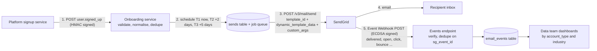

# Integration: signup webhook to SendGrid onboarding series

This document describes how a platform signup becomes three onboarding emails, and how opens, clicks and bounces come back to the data team tagged by segment. It is written so a developer can build the service from it. Every SendGrid behaviour below was checked against the current Twilio SendGrid docs (links at the end) on 31 Oct 2026.

## 1. How it fits together

SendGrid does not listen for our signup event. Our own onboarding service receives the platform webhook, decides what to send and when, and calls the SendGrid Mail Send API. SendGrid's Event Webhook then runs in the opposite direction, posting delivery and engagement events back to us.



| Direction | From | To | Auth |
|---|---|---|---|
| Inbound | Platform signup service | `POST /webhooks/signup` on the onboarding service | HMAC-SHA256 shared secret (proposed contract with the API team) |
| Outbound | Onboarding service | `POST https://api.sendgrid.com/v3/mail/send` | `Authorization: Bearer <API key>`, key restricted to Mail Send |
| Return | SendGrid Event Webhook | `POST /webhooks/sendgrid-events` on the onboarding service | ECDSA signature headers from SendGrid |

## 2. Inbound: the signup webhook

### 2.1 Event to listen for

One event: `user.signed_up`, fired by the platform after the account row is committed. We do not need login, profile-update or plan-change events for this series.

### 2.2 Payload the platform should send

```json
{
  "event": "user.signed_up",
  "event_id": "evt_01JBX2Q8M4",
  "occurred_at": "2026-10-31T09:14:00Z",
  "data": {
    "user_id": "usr_10482",
    "email": "dana.okafor@example.com",
    "first_name": "Dana",
    "account_type": "enterprise",
    "signup_date": "2026-10-31T09:14:00Z",
    "company_name": "Northwind Bank",
    "industry": "finance"
  }
}
```

The seven fields under `data` are the ones the API team already sends. The envelope (`event`, `event_id`, `occurred_at`) is a request to the API team: it lets us log and replay events and tells us which version of the payload we're reading. If they can't add it, the service still works, because deduplication uses `user_id` (section 6).

Headers we ask for:

| Header | Purpose |
|---|---|
| `Content-Type: application/json` | |
| `X-Signature: sha256=<hex>` | HMAC-SHA256 of the raw body with a shared secret, so only the platform can trigger sends |

### 2.3 Validation

The service validates before it schedules anything. A bad payload must never become a broken email.

| Field | Rule | If it fails |
|---|---|---|
| `user_id` | Required, non-empty string | 422, no send, alert |
| `email` | Required, valid address format | 422, no send, alert |
| `signup_date` | Required, ISO 8601 | 422, no send |
| `first_name` | Optional. Trimmed. Empty becomes missing | Template shows "there" |
| `company_name` | Optional. Trimmed | Template shows generic copy |
| `account_type` | Optional. Lowercased, trimmed | Unknown values get the default block in T2 and are logged |
| `industry` | Optional. Lowercased, trimmed | Unknown values get the default block in T3 and are logged |

The service answers `202 Accepted` once the sends are scheduled, and `200 OK` with no action for a duplicate (section 6). It answers fast and does the SendGrid calls from the queue, so a slow SendGrid response never makes the platform's webhook time out and retry.

## 3. Outbound: sending through SendGrid

### 3.1 Endpoint and auth

- Endpoint: `POST https://api.sendgrid.com/v3/mail/send`
- Auth: `Authorization: Bearer $SENDGRID_API_KEY`, using a **restricted** key with only the Mail Send permission. If the key leaks, it can send mail but can't read contacts or change settings.
- Success: `202 Accepted` with an empty body. The `X-Message-Id` response header is stored against the send.

### 3.2 The three templates

Each template is a SendGrid dynamic template (ID starts with `d-`). Template IDs live in environment variables, not code, so staging and production can point at different versions.

| template_key | Sequence step | Send at | Env var | Conditional on |
|---|---|---|---|---|
| `t1_welcome` | 1 | Immediately | `SENDGRID_TEMPLATE_T1` | none |
| `t2_account_type` | 2 | signup + 2 days | `SENDGRID_TEMPLATE_T2` | `account_type` |
| `t3_industry` | 3 | signup + 5 days | `SENDGRID_TEMPLATE_T3` | `industry` |

Subject lines are set in each template version's settings in SendGrid and use the same variables as the body:

| Template | Subject (Handlebars) |
|---|---|
| T1 | `Welcome to impact.com{{#if first_name}}, {{first_name}}{{/if}}` |
| T2 | `{{#equals account_type "enterprise"}}Set up impact.com for your whole team{{else}}{{#equals account_type "startup"}}Launch your partner program this week{{else}}Your next steps on impact.com{{/equals}}{{/equals}}` |
| T3 | `{{#equals industry "finance"}}How a digital bank grew with compliant partners{{else}}{{#equals industry "retail"}}Pay partners more for new customers{{else}}How brands like yours grow with partners{{/equals}}{{/equals}}` |

SendGrid's docs say to use triple braces for subject-line values that may contain `'`, `"` or `&`. None of the subjects above insert `company_name`, so that issue doesn't come up.

### 3.3 Why the scheduling is ours, not SendGrid's

Mail Send has a `send_at` field, but SendGrid rejects anything more than 72 hours ahead. T3 goes out on day 5, so the onboarding service schedules sends itself (a delayed job per row in the `sends` table) and calls Mail Send at send time without `send_at`. This also means a user who deletes their account on day 3 can be cancelled before T2 or T3 goes out, which a pre-scheduled SendGrid send would not allow.

### 3.4 Sample request (cURL)

This is the T2 send for the sample payload above.

```bash
curl --request POST \
  --url https://api.sendgrid.com/v3/mail/send \
  --header "Authorization: Bearer $SENDGRID_API_KEY" \
  --header "Content-Type: application/json" \
  --data '{
    "from": { "email": "onboarding@mail.impact.com", "name": "impact.com" },
    "reply_to": { "email": "onboarding-help@impact.com", "name": "impact.com Onboarding" },
    "template_id": "d-xxxxxxxxxxxxxxxxxxxxxxxxxxxxxxxx",
    "personalizations": [
      {
        "to": [{ "email": "dana.okafor@example.com", "name": "Dana" }],
        "dynamic_template_data": {
          "first_name": "Dana",
          "company_name": "Northwind Bank",
          "account_type": "enterprise",
          "industry": "finance"
        },
        "custom_args": {
          "user_id": "usr_10482",
          "template_key": "t2_account_type",
          "sequence_step": "2",
          "account_type": "enterprise",
          "industry": "finance"
        }
      }
    ],
    "categories": ["onboarding", "onboarding_t2_account_type"],
    "asm": { "group_id": 12345 },
    "tracking_settings": {
      "click_tracking": { "enable": true, "enable_text": false },
      "open_tracking": { "enable": true }
    },
    "mail_settings": {
      "sandbox_mode": { "enable": false }
    }
  }'
```

What each part does:

| Field | Where | Why |
|---|---|---|
| `from` | top level | Must be on an authenticated sending domain (SPF + DKIM, aligned for DMARC). A subdomain such as `mail.impact.com` keeps onboarding reputation separate from corporate mail. |
| `reply_to` | top level | The templates tell users to reply for help, so replies need to reach a monitored inbox. |
| `template_id` | top level | Selects the dynamic template. |
| `dynamic_template_data` | per personalization | The values the Handlebars template reads. Only what the template needs. |
| `custom_args` | per personalization | Returned on every Event Webhook event for this message. This is how the data team segments results. Values must be strings. |
| `categories` | top level | Groups stats in the SendGrid UI. Max 10 per message, 255 characters each. |
| `asm.group_id` | **top level** | The "Onboarding" unsubscribe group. The footer's `<%asm_group_unsubscribe_raw_url%>` and `<%asm_preferences_raw_url%>` links only render when this is present at the top level of the request, not inside `personalizations`. |
| `tracking_settings` | top level | Turns on SendGrid's own open pixel and click rewriting. The templates contain no manual pixel, so opens are counted once. |
| `mail_settings.sandbox_mode` | top level | `true` in tests: SendGrid validates the request, returns `200`, and delivers nothing. |

### 3.5 Responses and what the service does

| Status | Meaning | Action |
|---|---|---|
| `202` | Accepted for delivery | Mark send `sent`, store `X-Message-Id` |
| `200` | Sandbox mode, request valid | Test only |
| `400` | Invalid body (bad template ID, wrong field types) | Do not retry. Mark `failed`, alert. This is a bug in our code or config. |
| `401` / `403` | Bad or under-scoped API key | Do not retry. Page on-call. Every send will fail until it is fixed. |
| `413` | Payload too large | Do not retry. Alert. |
| `429` | Rate limited | Retry after `X-RateLimit-Reset` if present, else exponential backoff |
| `5xx` | SendGrid error | Retry with exponential backoff and jitter: 1s, 2s, 4s, 8s, 16s, then mark `failed` and alert |

A `202` means SendGrid accepted the message, not that it was delivered. Delivery is confirmed by the `delivered` event (section 5).

## 4. Data mapping

### 4.1 Field mapping

| Webhook field | Template variable | custom_args | Transform | Used in |
|---|---|---|---|---|
| `user_id` | | `user_id` | none | Event join key, idempotency key |
| `email` | (personalization `to`) | | none | Recipient. Never put in custom_args or categories. |
| `first_name` | `first_name` | | trim; empty becomes missing | T1, T2, T3 greeting; T1 subject |
| `company_name` | `company_name` | | trim | T1, T2, T3 body. Rendered with `{{ }}`, which HTML-escapes it |
| `account_type` | `account_type` | `account_type` | lowercase, trim; missing becomes `unknown` in custom_args | T2 conditional and subject; segmentation |
| `industry` | `industry` | `industry` | lowercase, trim; missing becomes `unknown` in custom_args | T3 conditional and subject; segmentation |
| `signup_date` | | | parse ISO 8601 | Scheduling T2/T3 only |
| (derived) | | `template_key`, `sequence_step` | from the send row | Per-email reporting |

Two deliberate choices:

- **Normalising in the service, not the template.** SendGrid's `equals` helper is an exact, case-sensitive match. `"Enterprise "` from the platform would silently get the default block. Lowercasing and trimming once, in code, keeps the templates simple and makes the rule testable.
- **Only what the template needs goes into `dynamic_template_data`.** Email and user_id stay out of the template data, so a template edit can never print them by mistake.

### 4.2 What the service sends to SendGrid (T2 example)

```json
{
  "personalizations": [
    {
      "to": [{ "email": "dana.okafor@example.com", "name": "Dana" }],
      "dynamic_template_data": {
        "first_name": "Dana",
        "company_name": "Northwind Bank",
        "account_type": "enterprise",
        "industry": "finance"
      },
      "custom_args": {
        "user_id": "usr_10482",
        "template_key": "t2_account_type",
        "sequence_step": "2",
        "account_type": "enterprise",
        "industry": "finance"
      }
    }
  ]
}
```

The rest of the body (`from`, `template_id`, `categories`, `asm`, `tracking_settings`) is the same as section 3.4.

## 5. Tracking and segmentation

### 5.1 Event Webhook configuration

In SendGrid: **Settings > Mail Settings > Webhook Settings > Event Webhooks > Create new webhook**.

- **Post URL:** `https://<onboarding-service>/webhooks/sendgrid-events`
- **Actions to be posted:**

| Event | Why we want it |
|---|---|
| `processed` | SendGrid accepted the message. Start of the funnel. |
| `delivered` | Receiving server accepted it. Denominator for open and click rates. |
| `deferred` | Temporary failure. A spike points to throttling at one mailbox provider. |
| `bounce` | Hard bounce (`type: bounce`) or block (`type: blocked`). Bounce rate by segment. |
| `dropped` | SendGrid didn't send, e.g. the address is on a suppression list or unsubscribed from the group. |
| `open` | Engagement, with caveats below. |
| `click` | Engagement. Our primary metric. |
| `spamreport` | Complaint. Must stay well under 0.3% (Gmail/Yahoo threshold). |
| `unsubscribe`, `group_unsubscribe`, `group_resubscribe` | Opt-outs from the Onboarding group, kept in sync with the platform's own preferences. |

- **Security:** turn on **Signed Event Webhook**. SendGrid generates the key pair on save; copy the public key into `SENDGRID_WEBHOOK_PUBLIC_KEY`.

### 5.2 Receiving events

SendGrid posts a JSON array of events. A `bounce` event for our T2 send looks like this (custom_args come back as top-level fields):

```json
[
  {
    "email": "dana.okafor@example.com",
    "timestamp": 1793438100,
    "event": "bounce",
    "type": "bounce",
    "reason": "550 5.1.1 The email account that you tried to reach does not exist",
    "sg_event_id": "ZGVsaXZlcmVkLTAtMTIzNDU2",
    "sg_message_id": "14c5d75ce93.dfd.64b469.filter0001.16648.5515E0B88.0",
    "category": ["onboarding", "onboarding_t2_account_type"],
    "user_id": "usr_10482",
    "template_key": "t2_account_type",
    "sequence_step": "2",
    "account_type": "enterprise",
    "industry": "finance"
  }
]
```

The endpoint does four things, in order:

1. **Verify the signature.** SendGrid sends `X-Twilio-Email-Event-Webhook-Signature` and `X-Twilio-Email-Event-Webhook-Timestamp`. Verify the ECDSA signature over the timestamp followed by the **raw request body**, using the public key. Parsing the JSON first and re-serialising it changes the bytes and breaks verification. Reject failures with `403`. Also reject timestamps more than a few minutes old to stop replays.
2. **Acknowledge fast.** Return `200` as soon as the batch is stored. Any non-2xx response makes SendGrid retry, at increasing intervals, for up to 24 hours, so slow processing turns into duplicate deliveries.
3. **Deduplicate on `sg_event_id`.** A unique constraint on that column means a retried batch inserts nothing new. SendGrid's own docs recommend this ID for deduplication.
4. **Store and process.** Insert into `email_events`. A hard bounce or spam report also cancels any remaining sends in the sequence for that user.

### 5.3 Table the data team queries

```sql
CREATE TABLE email_events (
  sg_event_id    TEXT PRIMARY KEY,          -- dedupe key
  sg_message_id  TEXT,
  event          TEXT NOT NULL,             -- delivered, open, click, bounce ...
  bounce_type    TEXT,                      -- bounce | blocked
  occurred_at    TIMESTAMPTZ NOT NULL,
  user_id        TEXT NOT NULL,
  template_key   TEXT NOT NULL,
  sequence_step  INT,
  account_type   TEXT,
  industry       TEXT,
  url            TEXT                       -- click events only
);
```

Click rate per template and account type:

```sql
SELECT template_key,
       account_type,
       COUNT(DISTINCT user_id) FILTER (WHERE event = 'delivered') AS delivered,
       COUNT(DISTINCT user_id) FILTER (WHERE event = 'click')     AS clicked,
       ROUND(100.0 * COUNT(DISTINCT user_id) FILTER (WHERE event = 'click')
             / NULLIF(COUNT(DISTINCT user_id) FILTER (WHERE event = 'delivered'), 0), 1) AS click_rate_pct
FROM email_events
GROUP BY template_key, account_type
ORDER BY template_key, account_type;
```

### 5.4 Custom tracking fields

| custom_args key | Example | Why |
|---|---|---|
| `user_id` | `usr_10482` | Join events back to the platform user without storing email in event data |
| `template_key` | `t2_account_type` | Which email |
| `sequence_step` | `2` | Funnel position. Survives template renames. |
| `account_type` | `enterprise` | Segment for T2 analysis, and a cut on every email |
| `industry` | `finance` | Segment for T3 analysis, and a cut on every email |

SendGrid warns that custom_args and categories may be stored long term and must not contain personal data. So: internal `user_id` only, never email, name or company name.

### 5.5 Reading the numbers honestly

- **Opens are inflated.** Apple Mail Privacy Protection preloads images, so the open pixel fires whether or not the person read the email. Some corporate mail filters do the same. Open rate is a deliverability signal, not an engagement signal.
- **Clicks are the primary metric**, measured per button through the `url` field and the `utm_content` value on every link (e.g. `t2_enterprise_consultant`).
- **Some clicks are bots.** Corporate link scanners click every link within seconds of delivery. Discount clicks that arrive within a few seconds of `delivered` on every link in the email at once.
- **The real outcome sits in the product.** The UTM parameters let the product team tie a click to "completed profile" or "installed tracking", which is what this series is for.

## 6. Idempotency and retries

Webhooks get delivered more than once. The platform may retry on a timeout, and a deploy may replay events. Every send gets an idempotency key:

```
idempotency_key = user_id + ":" + template_key      e.g. usr_10482:t2_account_type
```

The `sends` table has a unique constraint on this key. On a duplicate signup webhook, the insert fails, the service returns `200`, and nothing is sent twice. The same key protects the queue worker: before calling SendGrid it checks the row's status, so a worker crash after a successful `202` doesn't resend on restart.

## 7. Unsubscribes, authentication and compliance

- **Unsubscribe group.** Onboarding emails use their own ASM group, "Onboarding", separate from marketing. Someone who opted out of marketing still gets setup emails for an account they just created. Someone who unsubscribes from Onboarding is suppressed by SendGrid automatically (`dropped` event) and the platform is told via the `group_unsubscribe` event.
- **Domain authentication.** Production sends from an authenticated subdomain with SPF, DKIM and a DMARC policy. Gmail and Yahoo require this for bulk senders, together with one-click unsubscribe and a spam rate below 0.3%.
- **POPIA and similar laws.** Users get these emails because they created an account, which is a service relationship. We still offer an unsubscribe, include a physical address, and keep personal data out of tracking fields.

## 8. Configuration

| Variable | Example | Notes |
|---|---|---|
| `SENDGRID_API_KEY` | `SG.xxxx` | Restricted: Mail Send only. Stored in the secrets manager, never in git. |
| `SENDGRID_TEMPLATE_T1` | `d-...` | Dynamic template IDs |
| `SENDGRID_TEMPLATE_T2` | `d-...` | |
| `SENDGRID_TEMPLATE_T3` | `d-...` | |
| `SENDGRID_ASM_GROUP_ONBOARDING` | `12345` | Unsubscribe group ID |
| `SENDGRID_WEBHOOK_PUBLIC_KEY` | `MFkwEwYH...` | For Event Webhook signature checks |
| `SIGNUP_WEBHOOK_SECRET` | random 32 bytes | HMAC secret shared with the platform team |
| `SENDGRID_SANDBOX` | `true` | Forces `sandbox_mode` on outside production |

## 9. Adding emails and segments later

- **A new email:** add `src/emails/t4-*.html`, run `npm run build`, upload as a new dynamic template, add its ID and a `template_key` row to the schedule. Shared header and footer come in automatically.
- **A new segment** (e.g. `account_type: "agency"` or publishers): copy one block inside the existing `equals` chain and change the copy. Unknown values already fall back safely, so the data can arrive before the content does.
- **Template changes** go through git: edit the source, rebuild, review the diff, then paste into a new SendGrid template version. The SendGrid version history and the git history then tell the same story.

## Sources

- [Mail Send API reference](https://www.twilio.com/docs/sendgrid/api-reference/mail-send/mail-send): 202 response, `custom_args` and category limits, 72-hour `send_at` limit, top-level `asm`
- [Using Handlebars](https://www.twilio.com/docs/sendgrid/for-developers/sending-email/using-handlebars): `equals` with `else`, triple braces in subject lines
- [Sandbox mode](https://www.twilio.com/docs/sendgrid/for-developers/sending-email/sandbox-mode): `200` response, nothing delivered, no events
- [Group unsubscribes](https://www.twilio.com/docs/sendgrid/ui/sending-email/group-unsubscribes): ASM substitution tags
- [Event Webhook reference](https://www.twilio.com/docs/sendgrid/for-developers/tracking-events/event): event types, `sg_event_id` for deduplication, custom_args in events, no PII
- [Getting started with the Event Webhook](https://www.twilio.com/docs/sendgrid/for-developers/tracking-events/getting-started-event-webhook): setup path, 24-hour retry window
- [Event Webhook security features](https://www.twilio.com/docs/sendgrid/for-developers/tracking-events/getting-started-event-webhook-security-features): signature headers, ECDSA over timestamp + raw body
- [v3 API rate limits](https://www.twilio.com/docs/sendgrid/api-reference/how-to-use-the-sendgrid-v3-api/rate-limits): 429 and `X-RateLimit-*` headers
